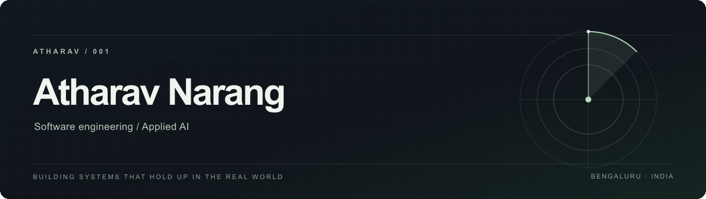
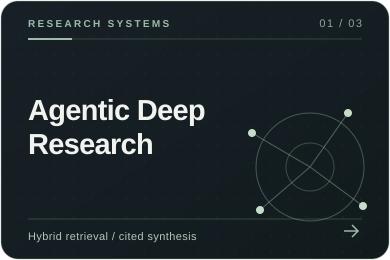
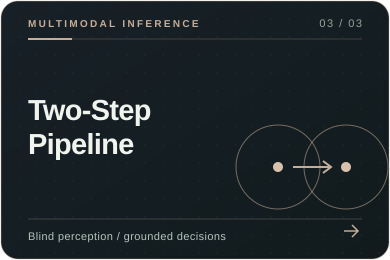

  
    
  
    
  <a href="https://atharav001.vercel.com">Portfolio ↗</a> &nbsp;&nbsp;·&nbsp;&nbsp;
  <a href="https://linkedin.com/in/atharav-narang-132b74273">LinkedIn ↗</a> &nbsp;&nbsp;·&nbsp;&nbsp;
  <a href="mailto:atharavnarang05@gmail.com">Email ↗</a>

 

### 01 / Selected work

  
  
  

 

### 02 / Contribution activity

  

 

Python · PyTorch · React · Swift · Docker &nbsp;&nbsp; / &nbsp;&nbsp; Building, measuring, refining.
