  
    
  <strong>Computer Science at MIT Bengaluru.</strong> I build reliable AI systems and useful software with a focus on clear thinking, careful evaluation, and craft.
    
  <a href="https://atharav001.vercel.com">Portfolio ↗</a> &nbsp;·&nbsp;
  <a href="https://linkedin.com/in/atharav-narang-132b74273">LinkedIn ↗</a> &nbsp;·&nbsp;
  <a href="mailto:atharavnarang05@gmail.com">Email ↗</a>

 

### 01 / Selected work

**[Agentic Deep Research ↗](https://github.com/Atharav001/RAG-Agentic-Deep-Research)**  
Local research over hundreds of papers with hybrid retrieval and evidence checks.

**[WhatsApp Message Router ↗](https://github.com/Atharav001/whatsapp-message-notification-router)**  
Multimodal notification routing with deterministic safety controls.

**[Two-Step Multimodal Pipeline ↗](https://github.com/Atharav001/Two-Step-Debiased-MultiModal-Pipeline)**  
Separates visual perception from decisions to reduce bias.

 

### 02 / Contribution activity

  

 

Python · PyTorch · React · Swift · Docker &nbsp;&nbsp; / &nbsp;&nbsp; Building, measuring, refining.
